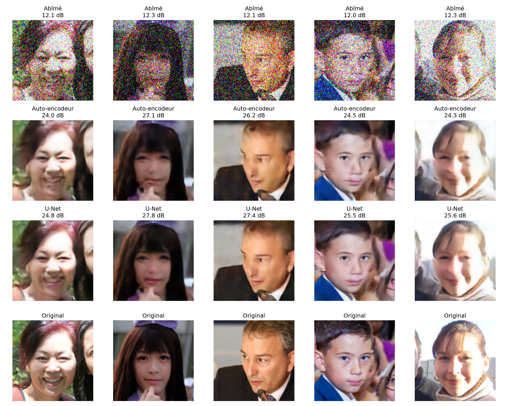

# 🧠 Débruiteur de visages : auto-encodeur vs U-Net (PyTorch)

Réseaux de neurones convolutifs entraînés à **retirer le bruit** de photos de visages, avec une **comparaison entre deux architectures** : un auto-encodeur classique et un U-Net à connexions résiduelles (skip connections).


*De haut en bas : visage bruité, réparé par l'auto-encodeur, réparé par le U-Net, original. Ces visages font partie du jeu de validation : les modèles ne les ont jamais vus pendant l'entraînement.*

---

## 📊 Résultats

Mesures réalisées sur les **14 000 images de validation**, avec un bruit gaussien d'écart-type **σ = 0,3**.

| Modèle | PSNR | Erreur (MSE) | Paramètres | Temps / époque* |
|---|---|---|---|---|
| Image bruitée (référence) | 12,0 dB | – | – | – |
| Auto-encodeur | 25,0 dB | 0,0032 | 233 379 | 194 s |
| **U-Net** | **26,0 dB** | **0,0025** | 445 539 | 243 s |

\* Entraînement sur un GPU NVIDIA RTX 3050 (6 Go).

**Gain : +14 dB de PSNR** par rapport à l'image bruitée, et **22 % d'erreur en moins** pour le U-Net par rapport à l'auto-encodeur.

---

## 🔬 Démarche

- **Données** : [FFHQ](https://github.com/NVlabs/ffhq-dataset) (70 000 visages), en version 128×128 pixels. Séparation **80 % entraînement / 20 % validation**, avec une graine fixe pour pouvoir reproduire les résultats.
- **Bruit** : bruit gaussien (σ = 0,3) **regénéré à chaque passage**, pour que le modèle ne puisse pas apprendre le bruit par cœur.
- **Modèle 1, l'auto-encodeur convolutif** : l'encodeur réduit l'image en 3 étapes (128 → 16 pixels de côté), jusqu'à un goulot d'étranglement de 64×16×16, soit une compression ×3. Le décodeur reconstruit ensuite l'image en 128×128.
- **Modèle 2, le U-Net** : même descente et même remontée, mais avec des **skip connections** qui relient chaque étage de l'encodeur à l'étage correspondant du décodeur.
- **Entraînement** : perte MSE, optimiseur Adam (lr = 1e-3), lots de 64 images, 10 époques. Le meilleur modèle est sauvegardé d'après l'erreur de validation.
- **Évaluation** : PSNR moyen sur le jeu de validation. Les deux modèles reçoivent exactement les mêmes images bruitées, pour une comparaison équitable.

## 💡 Analyse

- **L'auto-encodeur** élimine bien le bruit, mais produit des images **floues** : son goulot d'étranglement, trop petit pour garder le bruit, perd aussi les **détails fins** (yeux, cheveux, contours).
- **Le U-Net** corrige en grande partie ce défaut : les skip connections transmettent au décodeur l'**information spatiale** perdue dans le goulot. Les contours sont plus nets, et l'erreur baisse de 22 %.
- **Pas de surapprentissage** : l'erreur d'entraînement et l'erreur de validation restent quasi identiques pour les deux modèles (0,0026 contre 0,0025 pour le U-Net).
- Le U-Net battait encore son record à la 10ᵉ époque : un entraînement plus long améliorerait probablement le résultat.

---

## 📁 Structure du projet

| Fichier | Rôle |
|---|---|
| `donnees.py` | Chargement de FFHQ, séparation entraînement/validation, ajout du bruit à la volée |
| `modele.py` | Architectures `AutoEncodeur` et `UNet` |
| `entrainer.py` | Boucle d'entraînement, validation et sauvegarde du meilleur modèle |
| `match.py` | Comparaison des deux modèles (PSNR moyen et visualisation) |
| `tester.py` | Visualisation des résultats de l'auto-encodeur |
| `voir_visages.py`, `bruit.py` | Exploration des données et visualisation du bruit |
| `debruiteur.pth`, `debruiteur_unet.pth` | Poids des modèles entraînés |

## 🛠️ Installation et utilisation

```bash
git clone https://github.com/MACISSE223/debruiteur-visages.git
cd debruiteur-visages
python -m venv venv
venv\Scripts\activate          # Windows (sur Linux/Mac : source venv/bin/activate)
pip install -r requirements.txt
```

**Données** : télécharger [FFHQ_128.zip](https://huggingface.co/datasets/LIAGM/FFHQ_datasets/resolve/main/FFHQ_128.zip?download=true) (2 Go), puis l'extraire dans `data/`, de façon à obtenir `data/images128x128/`.

```bash
python match.py        # comparer les deux modèles déjà entraînés
python entrainer.py    # réentraîner (choisir le modèle dans le fichier)
```

## 🚀 Pistes d'amélioration

- Apprentissage résiduel : prédire le bruit plutôt que l'image propre
- Entraînement avec un niveau de bruit variable, pour un modèle plus robuste
- Entraînement plus long, avec une baisse progressive du taux d'apprentissage

---

## 📜 Crédits

Jeu de données **Flickr-Faces-HQ (FFHQ)** © NVIDIA Corporation (Karras et al., *A Style-Based Generator Architecture for Generative Adversarial Networks*, 2019), sous licence [CC BY-NC-SA 4.0](https://creativecommons.org/licenses/by-nc-sa/4.0/). Utilisé ici dans un cadre non commercial et pédagogique.